## Custom RTL Router Core for LEO Satellite Networks with ISL PHY

### **Overview:** 
- A passion-project to develop efficient, intuitive microarchitecture for a router switch core on LEO Satellites.
- Fully implemented and closed @ $f_{c}=175\text{ MHz}$ on Artix-7 XC7A200T-1CSG324C Speed-Grade: -1 with theoretical 1.4Gbps throughput (Params: **NUM_LINKS** = 2 (2 ISL Links ~ 3 Link Adapter Tx and Rx (+ 1 for simulated uplink and downlink) ~ 3 L3 Buffers).
- Includes pathways for 2x and 4x throughput advancement provided bus-width scaling.
- See [Microarchitecture Highlights](#microarchitecture-highlights)

### **Design Verification:** 
- Each module is verified using [CocoTB](https://www.cocotb.org/) & [Verilator](https://www.veripool.org/verilator/) with self-checking testbenches following Directed, and Constrained Random Verification/Score-boarding principles
- Global 90% Functional Coverage
- All testbenches are located under `./cocotb/{module_name}` alongside LCOV HTML coverage report
- E2E Satellite Network Scoreboarding Test with Generated Satellite Topologies (Inter and Cross Orbital Planes).
  - Parameters: (Number of Planes, Number of Sats per Plane).
  - Jinja Templates for Dynamic Test-bench generation from network topology
 

| RTL Module | Line Coverage Status | TestBench |
|---|---|---|
| `CRC` ||[Test Bench](./cocotb/CRC/crc_coco_tb.py)|
| `link_adapter_rx` ||[Test Bench](./cocotb/LINK_ADAPTER_RX/link_adapter_rx_coco_tb.py)|
| `l3_buffer` ||[Test Bench](./cocotb/L3_BUFFER/l3_buffer_coco_tb.py)|
| `crossbar_arbiter` ||[Test Bench](./cocotb/CROSSBAR_ARBITER/crossbar_arbiter_coco_tb.py)|
| `link_adapter_tx` ||[Test Bench](./cocotb/LINK_ADAPTER_TX/link_adapter_tx_coco_tb.py)|
| `l3_buffer_arbiter` ||[Test Bench](./cocotb/L3_BUFFER_ARBITER/l3_buffer_arbiter_coco_tb.py)|

#### **Full E2E Satellite Network Test (4 Orbital Planes, 4 Sats per Plane = 16 Sats):**   [Test Bench](./cocotb/SATELLITE_NETWORK/satellite_network_coco_tb.py)
| Metric | Result |
|---|---:|
| Simulation Duration | 500,005 ns (500.005 µs) |
| Average Network Traversal Latency | 47,169.35 ns (47.17 µs) |
| Worst Network Traversal Latency | 125,847.50 ns (125.85 µs) |
| Worst-Latency Packet | 1,471 bytes (SrcSat 15 → DestSat 6) |
| Global Network Throughput | 14.58 Gbps |
| Total Packets Routed | 1,600 |
| Total Packets Successfully Received at Dest | 1,124 (70.25%) |
| Total Bytes Succesfully Received at Dest | 885,690 bytes |
| Total Packets Dropped (L3 Buffer Full Events @ 64 Stored Packets (16KB) | 476 (29.75%) |

  
### **Implementation & Usage Report:**
**Target device:** AMD/Xilinx Artix-7 XC7A200T-SBG484-1

| Resource | Used | Available | Utilization |
|---|---:|---:|---:|
| Slice LUTs | 1,198 | 134,600 | 0.89% |
| LUTs as Logic | 1,051 | 134,600 | 0.78% |
| LUTs as Memory | 147 | 46,200 | 0.32% |
| Slice Registers (FFs) | 816 | 269,200 | 0.30% |
| Block RAM Tiles (RAMB36) | 9 | 365 | 2.47% |
| DSP Slices | 0 | 740 | 0.00% |
| Bonded IOBs | 34 | 285 | 11.93% |
| BUFG | 2 | 32 | 6.25% |
| MMCM | 1 | 10 | 10.00% |

### Implementation Summary

- **Logic footprint:** 1,198 LUTs and 816 flip-flops.
- **Memory footprint:** 9 BRAM36 blocks, with additional distributed memory implemented using LUTRAM and shift registers.
- **DSP utilization:** No DSP slices required.
- **Clocking:** Two global clock buffers and one MMCM instantiated.
- **Timing target:** 175 MHz router-core operating frequency.

The low logic and memory utilization leave substantial room for scaling the switching fabric, increasing buffer capacity, and widening the datapath to support higher aggregate throughput.

## RTL Modules, Microarchitecture, and Network Model

```mermaid
flowchart LR
    %% Neighbours: senders on the left, receivers on the right
    sat_b_tx["SAT B"]
    sat_c_tx["SAT C"]
    sat_b_rx["SAT B"]
    sat_c_rx["SAT C"]

    subgraph sat_a["SAT A: ROUTER CORE @ 200 MHz"]
        direction LR

        ingress_1["LASER_LINK_PHY<br/>Ingress 1<br/>I/OSERDES SDR @ 1600 MHz"]
        ingress_2["LASER_LINK_PHY<br/>Ingress 2<br/>I/OSERDES SDR @ 1600 MHz"]

        rx_1["LINK_ADAPTER_RX 1<br/>DECAPSULATE"]
        rx_2["LINK_ADAPTER_RX 2<br/>DECAPSULATE"]

        l3_buffer_1["L3 BUFFER 1"]
        l3_buffer_2["L3 BUFFER 2"]

        buf_arb_1{{"L3_BUFFER_ARBITER 1"}}
        buf_arb_2{{"L3_BUFFER_ARBITER 2"}}

        cb_arb_1{{"CROSSBAR_ARBITER 1"}}
        cb_arb_2{{"CROSSBAR_ARBITER 2"}}

        tx_1["LINK_ADAPTER_TX 1<br/>ENCAPSULATE"]
        tx_2["LINK_ADAPTER_TX 2<br/>ENCAPSULATE"]

        egress_1["LASER_LINK_PHY<br/>egress 1<br/>I/OSERDES SDR @ 1600 MHz"]
        egress_2["LASER_LINK_PHY<br/>egress 2<br/>I/OSERDES SDR @ 1600 MHz"]
    end

    %% Receive path (link 1, then link 2)
    sat_b_tx -- OISL1_RX --> ingress_1
    ingress_1 -- L2 FRAME --> rx_1
    rx_1 -- L3 PACKET --> l3_buffer_1

    sat_c_tx -- OISL2_RX --> ingress_2
    ingress_2 -- L2 FRAME --> rx_2
    rx_2 -- L3 PACKET --> l3_buffer_2

    %% Single Buffer <-> buf arbiter: read command goes in, packet bytes come out
    l3_buffer_1 <-- "READ DESC / L3 PACKET" --> buf_arb_1
    l3_buffer_2 <-- "READ DESC / L3 PACKET" --> buf_arb_2

    %% Buf Arbiter <-> every TX: every TX can request from every buffer
    %% (descriptor request goes to the arbiter, packet bytes come back)
    buf_arb_1  <-- "READ DESC / L3 PACKET" --> tx_1
    buf_arb_1  <-- "READ DESC / L3 PACKET" --> tx_2
    buf_arb_2  <-- "READ DESC / L3 PACKET" --> tx_1
    buf_arb_2  <-- "READ DESC / L3 PACKET" --> tx_2

    %% Single TX <-> Crossbar Arbiter
    cb_arb_1 -- "READ DESC" --> tx_1
    cb_arb_2 -- "READ DESC" --> tx_2

    %% Crossbar Arbiter <-> every L3 Buffer
    l3_buffer_1 -- "READ DESC" --> cb_arb_1
    l3_buffer_2 -- "READ DESC" --> cb_arb_1
    l3_buffer_1 -- "READ DESC" --> cb_arb_2
    l3_buffer_2 -- "READ DESC" --> cb_arb_2

    %% Transmit path
    tx_1 -- L2 FRAME --> egress_1
    egress_1 -- OISL1_TX --> sat_b_rx
    tx_2 -- L2 FRAME --> egress_2
    egress_2 -- OISL2_TX --> sat_c_rx
    %% Styling: shape by role, colour by link
    classDef phy fill:#e2e3e5,stroke:#6c757d,color:#000
    classDef link1 fill:#d1ecf1,stroke:#0c5460,color:#000
    classDef link2 fill:#d4edda,stroke:#155724,color:#000
    classDef buf_arbiter fill:#fff3cd,stroke:#b58900,color:#000
    classDef cb_arbiter fill:#ffe4db,stroke:#b58900,color:#000
    classDef sat fill:#f8d7da,stroke:#842029,color:#000
    class ingress_1,egress_1,rx_1,tx_1,l3_buffer_1 link1
    class ingress_2,egress_2,rx_2,tx_2,l3_buffer_2 link2
    class buf_arb_1,buf_arb_2 buf_arbiter
    class cb_arb_1,cb_arb_2 cb_arbiter
    class sat_b_tx,sat_c_tx,sat_b_rx,sat_c_rx sat
```

The router is implemented as a modular, parameterized SystemVerilog design. Each module is responsible for a discrete stage of packet reception, buffering, arbitration, forwarding, or transmission. The architecture supports multiple simultaneous ingress and egress links, with independent buffering and arbitration logic. Modules communicate independently over AXI busses.

### Core Modules

| RTL Module | Description |
|---|---|
| `laser_link_phy` | PHY-facing ingress and egress interfaces for the laser links, providing the serialization/deserialization boundary around the byte-wide router datapath. One-to-one mapping to a `link_adapter_rx` or `link_adapter_tx`|
| `link_adapter_rx` | Receives incoming L2 frames from it's `laser_link_phy`, decapsulates frames to yield L3 packets, validates frame integrity using CRC32, and drives L3 packet descriptors for `l3_buffer` insertion. |
| `l3_buffer` | Per-`link_adapter_rx` packet storage implemented using BRAM, with a separate descriptor memory for tracking committed packets and their locations. See: [**In-order descriptor advertisement, out-of-order servicing, in-order retirement:**](#anchor1) |
| `crossbar_arbiter` | Coordinates packet transfers between L3 packet buffers and respective next-hop mappings to egress adapters. Performs descriptor arbitration and stamps the selected source buffer ID. See [L3 Packet Descriptor](#l3-packet-descriptor) |
| `router_core` | Central routing fabric. Maintains the Forwarding Information Buffer (FIB) that performs destination-based next-hop lookups, and instantiates fabric crossbars and arbiters (`crossbar_arbiter` & `l3_buffer_arbiter`) for packet forwarding decisions|
| `link_adapter_tx` | Retrieves packet descriptors from `crossbar_arbiter` and commands for L3 payloads from `l3_buffer_arbiter`, encapsulates packets into L2 frames, calculates CRC32, and streams completed frames to it's `laser_link_phy` interface. |
| `l3_buffer_arbiter` | Arbitrates concurrent packet read requests from multiple egress adapters targeting a shared L3 buffer. |
| `CRC` | Parameterized CRC32 implementation using the reversed IEEE 802.3 polynomial (`0xEDB88320`). Used by `link_adapter_tx` for encapsulation and by `link_adapter_rx` for decapsulation + verification|

### Microarchitecture Highlights

- **Decoupled packet processing:** RX adapters, packet buffers, arbitration logic, and TX adapters operate independently through AXI-stream valid/ready handshakes.
- **BRAM-backed packet storage:** Packet payloads are stored separately from descriptors, reducing the amount of wide datapath state required in the control logic. Only descriptor-wide buses are utilized for packet routing decisions. On arbitration handshakes, AXI-streams facilitate   byte-streams of the underlying packet using the descriptor pointers into explicit L3 Buffers.
- **In-order descriptor advertisement, out-of-order servicing, in-order retirement:** L3 buffers advertise packet descriptors to the crossbar in ingress commit order, allowing independent egress adapters to service requests concurrently while simulatenously requesting L3 packet byte-streams out of order (w.r.t to the ingress commit order). Descriptor slots are tracked using `desc_id`, ensuring packets are retired in their original allocation order once their corresponding reads complete, maintaining ring-buffer invaraince.
- **Multi-egress buffer arbiter:** Each L3 buffer can route newly committed descriptors to the determined next-hop egress adpater, allowing flexible routing across the switch fabric. 
- **Multi-buffer crossbar arbiter:** Each egress adapter can request packets using forwarded descriptors from multiple ingress buffers, allowing flexible routing across the switch fabric.
- **Dynamic forwarding:** Per-satellite FIB entries determine the appropriate egress adapter for each destination satellite. 
- **Parameterized architecture:** Link count, packet sizes, buffer depths, descriptor widths, and related datapath dimensions are statically derived from shared parameters.

### Packet Formats and Network Model

All multi-byte fields are transmitted **least-significant byte first**. Frames and packets are streamed one byte per clock (8-bit AXI-Stream).

This Router Core fabricates a Novel ISL-contained L2 and L3 layer that encapsulates regular L3 Internet Traffic (IP ~ MTU = 1500B). The L1 PHY over laser links is abstracted away and is not in scope for this project

Each router core has a Forwarding Information Buffer (FIB) that can be dynamically updated from assumed ground stations. These FIBs contain shortest-path (OSPF-esque) next-hop mappings to go from the current sat to `dest_sat` by using a specific `link_adapter_tx`

**Note:** All the following fields are parametrized and statically derived from each other before runtime, making scaling straightforward and quick. See [`packets_and frames.sv`](https://github.com/cailean17/ISL_ROUTER_CORE/blob/master/RTL/packets_and_frames.sv)

#### L3 Packet

| Byte offset | Field | Size | Description |
|---|---|---|---|
| 0 | `SrcSat` | 1 B | Source satellite ID |
| 1 | `DestSat` | 1 B | Destination satellite ID, used by the FIB to pick the egress port |
| 2 | `TTL` | 1 B | Time to live |
| 3–4 | `Length` | 2 B | Packet length field |
| 5 … | `Payload` | up to 1500 B | Payload (MTU = `L3_PAYLOAD_MAX_SIZE_BYTES`) |
| last | `Reserved` | 1 B | Reserved |

- **Max L3 size:** 1506 B (`L3_MAX_SIZE_BYTES` = 1500 payload + 6 header).

#### L2 Frame

| Byte offset | Field | Size | Description |
|---|---|---|---|
| 0 | `SOF` | 1 B | Start of frame, fixed `0xAB` |
| 1 | `Type` / `Flags` | 1 B | `Type` in bits [7:4], `Flags` in bits [3:0]. Currently sent as `0x00` |
| 2–3 | `Length` | 2 B | Length of the L3 packet in bytes (header included), little-endian |
| 4 … | `L3 Packet` | up to 1506 B | The L3 packet |
| last 4 | `CRC32` | 4 B | CRC32, each byte inverted (XOR `0xFF`), low byte first |

- **Max L2 size:** 1514 B (`L2_MAX_SIZE_BYTES` = 1506 + 8 B of framing).
- **CRC coverage:** `Type/Flags`, `Length` and the L3 packet. `SOF` and the CRC itself are excluded.

#### L3 Packet Descriptor

Pointer to a L3 Packet stored in an `L3 Buffer` (BRAM)
For every packet, a descriptor is committed to the `l3_buffer`'s descriptor LUTRAM, and forwarded through the crossbar to the egress link adapter mapped by the FIB's next hop entry for the respective destination SAT. It's a 42-bit packed struct (`l3_packet_descriptor_t`).

| Bits | Field | Width | Description |
|---|---|---|---|
| [41:28] | `start_ptr` | 14 | Byte address of the packet's first byte in the packet BRAM (16 KB buffer) |
| [27:17] | `length` | 11 | L3 packet length in bytes (header included) |
| [16:9] | `dest_sat` | 8 | Destination satellite ID, looked up in the FIB |
| [8:3] | `desc_id` | 6 | Slot in the 64-entry descriptor buffer, used for in-order retirement |
| [2:0] | `buffer_id` | 3 | Source L3 buffer (0–3 = laser links, 4 = uplink) |

- **`buffer_id`** is written as `0` by the buffer. The `crossbar_arbiter` stamps the real value when it grants the descriptor to an egress adapter.
- **Lifecycle:** written on commit, advertised to the crossbar, handed to the TX adapter, used for the read command, then retired by `desc_id` after `read_done`.
